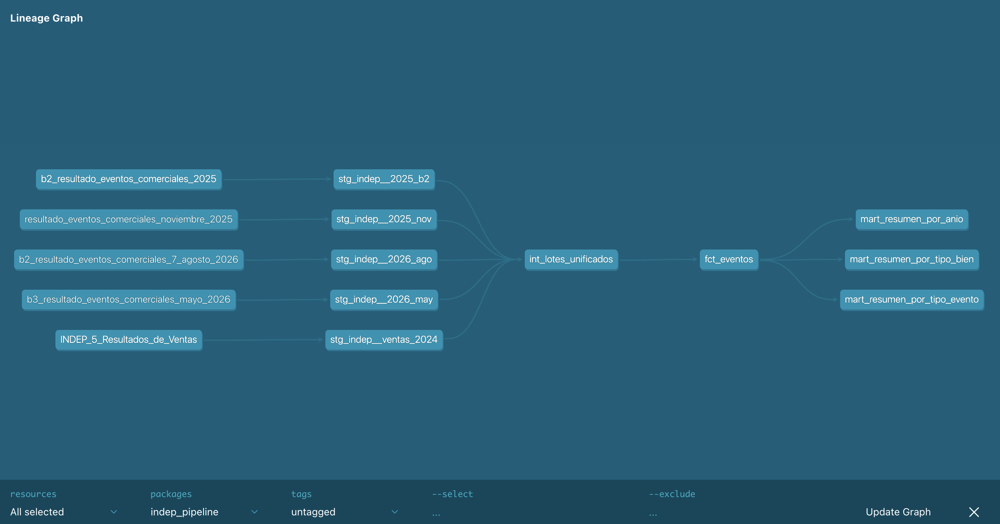

# Pipeline INDEP: dbt Core + DuckDB

Este proyecto es un pipeline ETL/ELT hecho con **dbt Core** y **DuckDB** (`indep.duckdb`). Sirve para limpiar, deduplicar y modelar los datos de los eventos comerciales del **INDEP** entre 2024 y 2026.

---

## Estructura del proyecto

```text
indep_pipeline/
├── seeds/                  # Los 5 CSV originales del INDEP
├── models/
│   ├── staging/            # Una vista por CSV (renombre de columnas, tipos y resultado_lote)
│   ├── intermediate/       # Unión 2024–2026, clave lote_sk y deduplicación
│   ├── marts/              # fct_eventos y 3 tablas resumen
│   └── schema.yml          # Tests de calidad
├── evidence/               # Capturas de la ejecución y del linaje
└── dbt_project.yml
```

---

## Qué encontré en los datos

Antes de modelar, revisé cada archivo y esto fue lo que salió:

- **2024** (`INDEP_5_Resultados_de_Ventas.csv`, 18,275 filas): las columnas venían sin guiones bajos, había una columna extra (`estadocomprador_etq`), 23 duplicados dentro del mismo archivo y regiones mezcladas en el campo `estado`.
- **2025** (`b2_resultado_eventos_comerciales_2025.csv` con 5,235 filas y `resultado_eventos_comerciales_noviembre_2025.csv` con 4,844): el corte de noviembre se traslapa con el consolidado anual, así que hay registros repetidos entre ambos.
- **2026** (`b3_resultado_eventos_comerciales_mayo_2026.csv` con 967 filas y `b2_resultado_eventos_comerciales_7_agosto_2026.csv` con 1,425): el corte de agosto ya incluye los lotes de mayo, más los eventos nuevos.

### Limpieza que apliqué

- Normalicé `resultado_lote` a tres valores: `'Vendido'`, `'Desierto'` y `'Otro / sin venta'`.
- Convertí los vacíos y los `'-'` a `NULL`.
- Creé una clave única `lote_sk` y deduplicé en `int_lotes_unificados`.

---

## Modelos principales

- **Staging:** 5 vistas `stg_indep__*`, sin joins. Solo renombran, tipan y limpian.
- **Intermediate:** `int_lotes_unificados`, que junta todo y queda con **24,912 lotes únicos** identificados por `lote_sk`.
- **Marts:**
  - `fct_eventos`: calcula los días entre la convocatoria y el fallo, y el sobreprecio.
  - `mart_resumen_por_anio`, `mart_resumen_por_tipo_evento` y `mart_resumen_por_tipo_bien`: resúmenes que incluyen la tasa de venta.

---

## Cómo correrlo

```bash
python3 -m venv .venv
source .venv/bin/activate
pip install dbt-core dbt-duckdb
dbt debug
dbt build
dbt docs generate && dbt docs serve
```

---

## Lineage Graph


